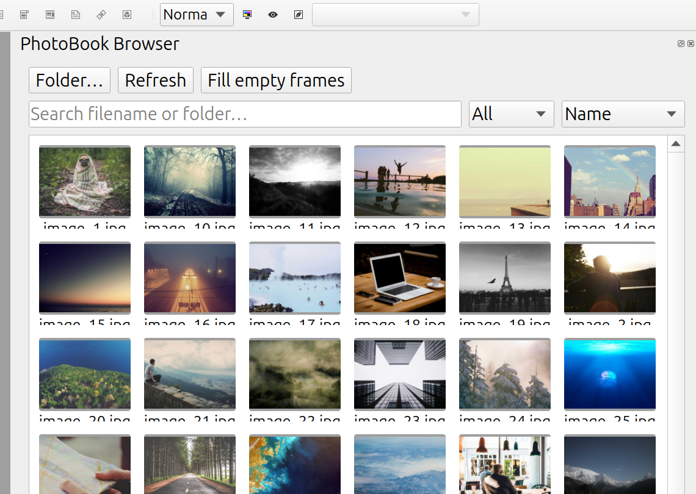
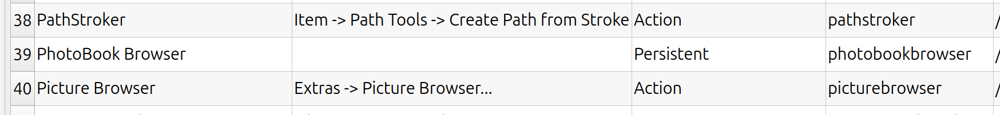

# Scribus PhotoBook Browser

**Keep track of every photo in your Scribus photo book.**

PhotoBook Browser is a native C++/Qt plugin for [Scribus](https://www.scribus.net/). It gives you a visual overview of the pictures in a folder and shows which ones are already placed in the open document — so you can find unused pictures instead of accidentally repeating the same image.



## Why use it?

Scribus' built-in Picture Browser is useful for browsing image files. PhotoBook Browser focuses on a different part of the workflow: **tracking which images from your photo collection have already been used in the current document**.

It is particularly useful for:

- Photo books and family albums
- Travel books and holiday albums
- Catalogues and other image-heavy publications
- Any Scribus document assembled from a large folder of pictures

## Features

- Browse image files as thumbnails, including images in subfolders.
- See whether each image is **used** or **unused** in the active Scribus document.
- Filter the list to show all, used or unused images.
- Search by filename or folder.
- See the page numbers on which an image is placed.
- Keep usage information up to date while you work.
- Insert an image into the current page or replace the selected image frame.
- Drag thumbnails directly onto the Scribus canvas.
- Fill empty image frames with unused photos.
- Remember the last photo folder between sessions.

Supported image formats include JPEG, PNG, TIFF, WebP, BMP, GIF and JPEG 2000 (depending on the image support available in your Scribus build).

## Download

[**Download the latest release →**](https://github.com/Uhrendoktor/scribus-photobookbrowser/releases)

The published release binaries are currently for **Linux x86-64**. The latest existing release may not yet contain the newly added Scribus 1.6.7 and 1.7.4 builds; those become downloadable from Releases after the next tagged build completes. Choose the file matching the exact Scribus version shown in **Help → About Scribus**. Scribus plugins are tied to the Scribus and Qt ABI they were built against; a plugin built for one Scribus release is not necessarily compatible with another.

### Build and compatibility status

| Platform | Scribus version(s) built in CI | Binary availability |
|---|---|---|
| Linux x86-64 | 1.6.5, 1.6.6, 1.6.7, 1.7.0, 1.7.1, 1.7.2, 1.7.3, 1.7.4 | CI artifacts; included in the next tagged release |
| macOS | 1.7.4 (Qt 6) | CI compile check; no end-user release package yet |
| Windows | 1.6.6 (MSYS2 UCRT64 / MinGW) | CI compile check only; **not compatible with the official MSVC Scribus installer** |

The 1.6.x series uses Qt 5; the 1.7.x series uses Qt 6. The Linux release workflow builds each listed Scribus version separately.

The Windows job currently uses the MSYS2 MinGW package recipe to check that the plugin compiles in a MinGW-built Scribus environment. Scribus' official Windows builds use MSVC, so this DLL must not be installed into the ordinary Scribus Windows installer.

## Installation (Linux)

1. In Scribus, open **Help → About Scribus** and note the full version number.
2. Download the matching `.so` file from the [latest release](https://github.com/Uhrendoktor/scribus-photobookbrowser/releases).
3. Copy the downloaded file into the plugin directory used by your Scribus installation.

   Common locations include:

   | Scope | Path |
   |---|---|
   | User | `~/.local/lib/scribus/plugins` |
   | System | `/usr/lib/scribus/plugins` |

   For example:

   ```bash
   mkdir -p ~/.local/lib/scribus/plugins
   cp ~/Downloads/photobookbrowser-*-linux-x86_64.so \
      ~/.local/lib/scribus/plugins/libphotobookbrowser.so
   ```

4. Restart Scribus.
5. Open **File → Preferences → Plugins** and confirm that PhotoBook Browser is loaded.



Plugin locations can differ between distribution packages, AppImages and custom Scribus builds. Use the plugin directory belonging to your Scribus installation if it differs from the paths above.

## Getting started

1. Open your photo book in Scribus.
2. Open **PhotoBook Browser** from the **Windows** menu.
3. Select the folder containing your photos.
4. Browse the thumbnails. The status and page information show which pictures are already in the document.
5. Choose **Unused** to focus on pictures that have not been placed yet.
6. Double-click a thumbnail to add it to the current page. The context menu also offers **Replace selected image frame**.
7. Alternatively, drag a thumbnail onto the page, or use **Fill empty frames** to place unused pictures into empty image frames.

The browser watches the selected photo folder and refreshes its list when files are added, removed or renamed. Usage status is refreshed as the document changes.

## Building from source (Linux)

The supplied Docker build creates Scribus and the plugin against the same Scribus/Qt environment. This avoids linking the plugin against headers or libraries from a different Scribus build.

Requirements: Docker and a Linux x86-64 host.

Build examples:

```bash
# Stable Scribus 1.6.x / Qt 5
SCRIBUS_VERSION=1.6.7 ./build-plugin.sh

# Development Scribus 1.7.x / Qt 6
SCRIBUS_VERSION=1.7.4 ./build-plugin.sh
```

The resulting plugin is written to `dist/`.

## Continuous integration

GitHub Actions builds Linux binaries for Scribus 1.6.5–1.6.7 and 1.7.0–1.7.4. It also runs a native macOS compile check against Scribus 1.7.4 and a Windows compile check against the MSYS2 UCRT64/MinGW Scribus build.

CI artifacts are retained for 14 days. Tagged releases publish the Linux binaries to the GitHub release.

## Contributing

Bug reports, compatibility reports, suggestions and pull requests are welcome. When reporting a build or loading problem, include:

- Operating system and architecture
- Exact Scribus version
- How Scribus was installed (distribution package, official installer, AppImage, custom build, etc.)
- Any relevant build output or Scribus log messages

## License

GPL-2.0-or-later.
